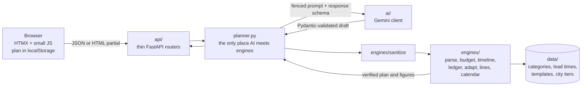

# Toran

An event planner for Indian weddings, birthdays and community events. Built for Google
PromptWars Virtual, Challenge 5 (Celebration & Event Planner).

**Live:** https://toran-event-planner.vercel.app (try the one-click sample wedding, no
sign-up)

## The problem

An Indian wedding is not one event. It is four to six functions (haldi, mehendi, sangeet,
the wedding, the reception), each with its own guests, menu, vendors and timings, paid for
by two families. Budgets get set before anyone checks a price, then get cut. Vendors
cancel. Good caterers and decorators book out months ahead, and families find out too late.
Existing planners hand over a static checklist and leave the family to redo the maths every
time something changes.

**Who it is for:** the family member actually running the wedding, usually a sibling or a
parent, not the couple. Birthday hosts and housing society committees use the same planner
through function templates.

## What Toran does

- **Describe it in one line.** "Sister's wedding in Jaipur, Feb 2027, about 400 guests, 25
  lakh budget." Gemini turns it into a brief and asks only about what is missing.
- **Get a full plan.** Every function with its own budget slice, a timeline counted back
  from real vendor lead times, ideas per function, and a list of what needs action now.
- **Try what-ifs.** Change the total, the guests, a function's setup level or a category.
  Every open line rebalances instantly; booked or paid lines never move. No AI call.
- **Something changed?** Report a budget cut, a vendor cancelling, more guests, a new date
  or a dropped function. Toran shows the impact first, then up to three fixes, each checked
  by the engines before you see it, with real figures side by side. A cancelled vendor
  adds a "book a replacement" task, flagged at risk when time is short.
- **Who pays.** Add each side or family member with a pledge, assign each budget line to
  one payer or a percentage split, and see pledged, assigned, paid and balance per person.
- **Bookings.** Mark lines booked or paid with the actual cost; they lock, their task is
  done, and any overspend is shown line by line.
- **Calendar.** Download every task and function as a calendar file, or add any task to
  Google Calendar with one link.
- **Your plan stays with you.** It is saved in your browser only. Download it as a file, open
  it on another device, and undo the last change.

## The core rule: Gemini proposes, engines verify

The AI never computes money or dates. Gemini reads the text, asks questions, suggests
functions and ideas, and proposes fixes as a small set of named operations. Plain, tested
Python turns that into rupees and dates and checks every result before the user sees it.



- `engines/` is pure Python with no I/O and never imports `ai/`, `api/` or `planner.py`
  ([tests/unit/test_boundaries.py](tests/unit/test_boundaries.py)).
- Every Gemini answer passes a response schema, Pydantic validation and
  [engines/sanitize.py](app/engines/sanitize.py) before any engine uses it.
- Every fix Gemini proposes is applied to a copy, checked against every invariant, and
  dropped if it does not solve the problem. Applying a fix re-runs it on the server; a plan
  computed by the browser is never accepted.

More detail: [ARCHITECTURE.md](ARCHITECTURE.md). How each part of the challenge maps to a
feature, a file and a test: [docs/PROBLEM_ALIGNMENT.md](docs/PROBLEM_ALIGNMENT.md).

## Where Gemini is used

| Step | What Gemini does | Model | Code |
|---|---|---|---|
| Intake | Reads the one-line description into raw values (amount and unit, date parts, city, guests) and up to three questions | `gemini-3.5-flash-lite` | [ai/service.py](app/ai/service.py) `extract_brief`, [planner.py](app/planner.py) `intake` |
| Generate | Suggests functions, category weights and ideas for the brief | `gemini-3.8-flash` | [ai/service.py](app/ai/service.py) `propose_plan`, [planner.py](app/planner.py) `generate` |
| Something changed | Proposes up to three fixes as operations (lower guests, change setup level, scale a category, drop an item) with a plain rationale | `gemini-3.8-flash` | [ai/service.py](app/ai/service.py) `propose_options`, [planner.py](app/planner.py) `adapt_options` |

How the calls are made ([ai/client.py](app/ai/client.py), [ai/prompts.py](app/ai/prompts.py),
[ai/schemas.py](app/ai/schemas.py)):

- Async google-genai client. Every call sets a system instruction, a response schema,
  explicit safety settings and an output token cap.
- One overall deadline per request (25 seconds). Invalid output is retried once. An
  overloaded, rate-limited or hung model hands over to the next one in the fallback chain
  (`gemini-3.6-flash`, then `gemini-3.5-flash-lite`).
- Everything the user typed is fenced in tags and treated as data, not instructions.
- If Gemini is unavailable, each step falls back to rule-based defaults and says so with a
  visible banner that survives a reload. Never silent.
- A daily cap on Gemini calls (`AI_DAILY_CALL_LIMIT`) guards against loops and abuse.

Other Google services: **Google Calendar** links for every task
([web/links.py](app/web/links.py)) and **Google Fonts** (Noto Sans and Rozha One).

## Run it locally

Needs Python 3.12. The app runs without a Gemini key: every AI step then uses its
rule-based fallback, with a banner, and the one-click sample needs no AI at all.

Bash:

```bash
python -m venv .venv
source .venv/bin/activate          # Windows Git Bash: source .venv/Scripts/activate
pip install -r requirements-dev.txt
cp .env.example .env               # then put your AI Studio key in GEMINI_API_KEY
uvicorn app.main:app --reload
```

PowerShell:

```powershell
python -m venv .venv
.venv\Scripts\Activate.ps1
pip install -r requirements-dev.txt
Copy-Item .env.example .env        # then put your AI Studio key in GEMINI_API_KEY
uvicorn app.main:app --reload
```

Open http://127.0.0.1:8000. API docs are at `/docs` outside production.

On Windows, clone into a short path (such as `C:\code\toran`) or enable long paths:
Playwright's package has deeply nested files that can exceed the 260-character limit.

### Environment variables

All of them are listed with defaults in [.env.example](.env.example). Secrets live only in
`.env` locally (git-ignored) and in the Vercel dashboard for production.

| Variable | Default | Purpose |
|---|---|---|
| `GEMINI_API_KEY` | empty | AI Studio key. Empty means rule-based fallbacks with a banner. |
| `ENVIRONMENT` | `development` | `production` hides `/docs` (Vercel's own `VERCEL_ENV` does too). |
| `GEMINI_MODEL` | `gemini-3.8-flash` | Generate and Something changed. |
| `GEMINI_LITE_MODEL` | `gemini-3.5-flash-lite` | Intake. |
| `GEMINI_FALLBACK_MODELS` | `gemini-3.6-flash,gemini-3.5-flash-lite` | Tried in order on overload, rate limit or a hang. |
| `AI_DEADLINE_SECONDS` | `25` | Time budget for one AI-backed request. |
| `AI_DAILY_CALL_LIMIT` | `500` | Gemini calls per IST day, retries included. `0` turns AI off. |
| `RATE_LIMIT_LLM` | `10/minute` | Per-IP limit on the three routes that call Gemini. |
| `MAX_BODY_BYTES` | `262144` | Largest accepted request body. |

## Tests

```bash
ruff check . && mypy app && pytest     # lint (with bandit rules), strict types, tests
pytest --cov                           # with coverage (CI enforces an 80% floor)
```

- **Unit and API tests** (`tests/`) run with a fake Gemini client injected through a
  FastAPI dependency override. They cover every engine invariant (lines sum to the budget
  to the rupee, no task after the event, locked lines never move, every shown option
  passes), every AI failure mode and its banner, the API routes, and the security controls.
- **End-to-end** (`e2e/`): a real browser drives the real app (served in-process with the
  fake Gemini) through describe, questions, plan, what-if, budget cut, pick a fix, export
  and reload, at phone and desktop size, plus a keyboard-only path and axe-core
  accessibility scans.

  ```bash
  python -m playwright install chromium
  pytest e2e
  ```

  To use a browser you already have instead: `E2E_BROWSER_CHANNEL=chrome pytest e2e`
  (PowerShell: `$env:E2E_BROWSER_CHANNEL = "chrome"; pytest e2e`).
- **Live evals** (`tests/evals/`): six real-style briefs (Telugu wedding, North Indian
  wedding, Hinglish input, 5th birthday, society Ganesh festival, wedding three weeks away)
  through intake, generate and Something changed on real Gemini. Checks schema validity and
  every engine invariant, and records model and latency per call. Needs a key and uses
  your quota, so it is a separate command and not part of CI.

  ```bash
  python -m tests.evals.run_evals            # add --save to refresh the replay fixtures
  ```

  Saved live responses are replayed offline by
  [tests/unit/test_eval_fixtures.py](tests/unit/test_eval_fixtures.py).

CI ([.github/workflows/ci.yml](.github/workflows/ci.yml)) runs lint, types, tests with the
coverage floor, a dependency audit (pip-audit) and the end-to-end suite on every push.

## Deployment and releases

Hosted on Vercel (FastAPI preset, Mumbai region). Every push to `main` deploys to
production. `GEMINI_API_KEY` and `ENVIRONMENT=production` are set in the Vercel dashboard,
never in the repository. `/healthz` reports the deployed commit, so production can be
matched to a tag.

A release is a tagged commit whose production deployment is green and checked live:

1. `ruff check . && mypy app && pytest` and `pytest e2e` pass locally; CI is green.
2. `python -m tests.evals.run_evals` passes on live Gemini.
3. Push `main`, wait for Vercel, and check that the `commit` in
   https://toran-event-planner.vercel.app/healthz matches `git rev-parse --short HEAD`.
4. Run the end-to-end checks against production. With `BASE_URL` set, the flows that need
   the fake Gemini are skipped, so this spends no AI quota:

   ```bash
   BASE_URL=https://toran-event-planner.vercel.app pytest e2e
   ```

   PowerShell: `$env:BASE_URL = "https://toran-event-planner.vercel.app"; pytest e2e`
5. Open the live link on a phone and run through the sample.
6. Tag the commit and push the tag: `git tag -a v1.0.0 -m "Challenge 5 submission"` and
   `git push origin v1.0.0`.

## Security

Strict CSP with no inline scripts or styles, security headers on every response, request
body cap, per-IP rate limits on the Gemini routes, Pydantic limits on every input including
imported plans, user text fenced in every prompt, generic errors with a request id, no
cookies and no server-side storage, secrets only in environment variables, pinned and
audited dependencies. Details, threat model and the test behind each control:
[docs/SECURITY.md](docs/SECURITY.md).

## Accessibility

Semantic landmarks and a skip link, labelled inputs, a keyboard path for everything
(checked end to end), visible focus, one live region for results and errors, slider values
read out in Indian format ("₹25 lakh"), status shown in text and not colour alone, WCAG AA
contrast for every colour pair (checked by
[tests/unit/test_theme.py](tests/unit/test_theme.py)), reduced motion respected, and axe-core
scans with no serious or critical issues.

## Project layout

```
app/
  main.py, config.py, security.py, planner.py
  engines/   pure Python: parse, sanitize, budget, timeline, ledger, adapt, lines, calendar
  ai/        Gemini client, prompts, response schemas, service
  api/       thin routers: pages, plan, budget, adapt, people, lines, calendar, health
  models/    Pydantic domain models
  data/      reference JSON (categories and per-plate ranges, lead times, templates, city tiers)
  web/       Jinja2 templates, static CSS, JS and hand-drawn SVGs
tests/       unit, api, fixtures, evals
e2e/         Playwright and axe-core
docs/        PROBLEM_ALIGNMENT.md, SECURITY.md
```

## Limits worth knowing

- Amounts are rough defaults from reference data, not vendor quotes, and the UI says so.
- On Gemini's free tier the Flash models often answer 503 (busy) or 429 (quota used). The
  fallback chain then serves the request from `gemini-3.5-flash-lite`, and the engines
  check its output the same way.
- Rate limits and the daily call cap are kept in memory, so on Vercel they count per
  serverless instance.
